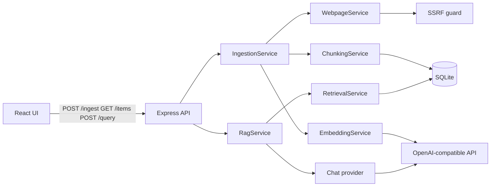

# AI Knowledge Inbox

A single-user knowledge base. Save a plain-text note or a public web page, then ask a question. The app retrieves the most similar saved passages and asks a language model to answer using only those passages, with citations back to the real chunks.

## Features

- Save a note or an HTTP(S) URL. Pages are fetched on the server, not in the browser.
- Extract readable text with Mozilla Readability, then chunk, embed, and store it in SQLite.
- List saved items with type, status, timestamp, preview, and the original URL.
- Ask a question. The answer includes the source title, type, excerpt, chunk id, similarity score, and a link for URL sources.
- If nothing relevant is saved, the app says the content is not enough. It does not invent an answer.
- Reject local, private, and credentialed URLs before any request is made, including after redirects.
- Structured JSON logs with a request id. API keys and document bodies are not logged.

Authentication, multi-user workspaces, crawling, and browser automation are intentionally out of scope.

## Architecture



Ingestion is synchronous. `POST /ingest` returns **201** only after the chunks and embeddings are stored and the item is `completed`. A failed embedding or extraction marks the item `failed` and removes any partial chunks, so it cannot be searched.

## Technology choices

| Piece | Choice | Why |
| --- | --- | --- |
| Frontend | React 18, TypeScript, Vite | Component-based UI with a small dependency set. Styling is one stylesheet, not a component library. |
| Backend | Node.js, Express, TypeScript | Thin controllers, services for ingestion and RAG, repositories for SQL. |
| Database | `node:sqlite` (`DatabaseSync`) | File-backed SQLite with no native addon to compile. Node 22.13+ or 24 is required. The API is still marked experimental by Node and may print a startup warning. |
| Vectors | JSON arrays in SQLite, exact cosine similarity | The collection is small. An exact scan is correct and easy to explain. It is not an approximate nearest-neighbor index. |
| HTML | `jsdom` + `@mozilla/readability` | Main article text without executing page scripts. |
| Models | `text-embedding-3-small`, `gpt-4o-mini` | OpenAI-compatible defaults. Both names are environment settings. |

## Prerequisites

- Node.js 22.13 or newer (verified on Node 24). `node:sqlite` must be available.
- npm 10 or newer.
- An OpenAI API key, or a compatible provider, for live embeddings and answers. Automated tests do not need a key.

## Environment

Copy `backend/.env.example` to `backend/.env`. Do not commit `.env`.

| Variable | Required | Default | Purpose |
| --- | --- | --- | --- |
| `OPENAI_API_KEY` | Yes, for live AI calls | empty | Sent only as an `Authorization` header. Never logged. |
| `PORT` | No | `4000` | Backend port. |
| `NODE_ENV` | No | `development` | Informational. |
| `DATABASE_PATH` | No | `./data/knowledge.db` | SQLite file, created on startup. Relative to the backend working directory. |
| `OPENAI_BASE_URL` | No | `https://api.openai.com/v1` | Compatible providers can replace this. |
| `OPENAI_CHAT_MODEL` | No | `gpt-4o-mini` | Chat model. Must support JSON object responses. |
| `OPENAI_EMBEDDING_MODEL` | No | `text-embedding-3-small` | Used for both documents and questions. |
| `CHUNK_SIZE` | No | `500` | Target chunk size in approximate tokens. |
| `CHUNK_OVERLAP` | No | `75` | Overlap in approximate tokens. Must be smaller than `CHUNK_SIZE`. |
| `RETRIEVAL_TOP_K` | No | `5` | Default number of passages. A request can override it from 1 to 20. |
| `RETRIEVAL_MIN_SCORE` | No | `0.25` | Minimum cosine similarity. Below this, the model is not called. |
| `MAX_CHUNKS_PER_ITEM` | No | `3` | Caps how many chunks from one item can fill the context. |
| `MAX_URL_BYTES` | No | `2000000` | Maximum page download size. |
| `REQUEST_TIMEOUT_MS` | No | `10000` | Timeout for page fetches, embeddings, and chat. |
| `FRONTEND_ORIGIN` | No | `http://localhost:5173` | CORS origin. |

Optional frontend setting in `frontend/.env`:

- `VITE_API_BASE_URL` defaults to `http://localhost:4000`.

Changing `OPENAI_EMBEDDING_MODEL` after data has been indexed is rejected until you delete the database and ingest again. Mixed vector sizes are not searched together.

## Install and run

From the repository root:

```bash
npm run install:all
```

In one terminal:

```bash
cd backend
npm run dev
```

In another:

```bash
cd frontend
npm run dev
```

Open `http://localhost:5173`. The API listens on `http://localhost:4000`.

Production-style checks:

```bash
npm test
npm run build
```

`backend` `build` is `tsc --noEmit`. The server runs through `tsx`. `frontend` `build` typechecks and emits `frontend/dist`.

## Database

Startup runs `CREATE TABLE IF NOT EXISTS`, enables foreign keys, and turns on WAL for file databases. Restart does not delete rows. Items left in `pending` or `processing` because the process stopped are marked `failed` on the next boot so they are not treated as searchable.

The file is `backend/data/knowledge.db` unless `DATABASE_PATH` is set. Delete that file to reset the inbox.

### Schema

`items`

- `id`, `title`, `source_type` (`note` or `url`), `original_url`
- `raw_content` so chunks can be rebuilt later
- `created_at`, `updated_at`
- `ingestion_status`: `pending`, `processing`, `completed`, `failed`
- `error_message`

`chunks`

- `id`, `item_id` (foreign key, `ON DELETE CASCADE`), `chunk_index`
- `content`
- `embedding` as a JSON array of numbers
- `created_at`

`app_meta`

- Stores the embedding model name and vector dimension used for the current index.

## API

Successful responses use `{ "success": true, "data": ... }`. Errors use `{ "success": false, "error": { "code", "message" } }`. Stack traces, SQL, and provider bodies are not returned.

### `GET /health`

```json
{ "success": true, "data": { "status": "ok", "database": "ok" } }
```

### `POST /ingest`

Note:

```bash
curl -X POST http://localhost:4000/ingest \
  -H "Content-Type: application/json" \
  -d "{\"sourceType\":\"note\",\"title\":\"React Hooks\",\"content\":\"React Hooks allow functional components to use state.\"}"
```

URL:

```bash
curl -X POST http://localhost:4000/ingest \
  -H "Content-Type: application/json" \
  -d "{\"sourceType\":\"url\",\"url\":\"https://example.com\"}"
```

`201` when indexing finished:

```json
{
  "success": true,
  "data": {
    "item": {
      "id": "item-id",
      "title": "React Hooks",
      "sourceType": "note",
      "originalUrl": null,
      "createdAt": "2026-10-19T07:01:00.000Z",
      "updatedAt": "2026-10-19T07:01:03.000Z",
      "status": "completed",
      "errorMessage": null,
      "preview": "React Hooks allow functional components to use state."
    }
  }
}
```

Validation and unsafe URLs return `400` and are not stored. A page that is too large, the wrong type, empty, or unreachable is stored as `failed` and the request returns `413`, `415`, `422`, or `502` with a safe message.

### `GET /items?limit=20&offset=0&sourceType=note`

Newest first. Each item includes a short preview, not the raw body and not the embedding. `limit` max is 50.

### `POST /query`

```bash
curl -X POST http://localhost:4000/query \
  -H "Content-Type: application/json" \
  -d "{\"question\":\"What do my notes say about React Hooks?\",\"topK\":5}"
```

`200` for both a grounded answer and an insufficient-evidence answer. Sources are built from retrieved rows. Titles, URLs, snippets, and scores are not taken from the model.

Status codes in use: `200`, `201`, `400`, `404`, `409` (embedding model mismatch), `413`, `415`, `422`, `429`, `502`, `503`, `500`.

## Ingestion pipeline

1. Validate the body. Notes need a title and content. URLs must be `http` or `https`.
2. For a URL, parse it, reject unsafe hosts, resolve DNS, and connect only to a public address that was checked. Redirects are followed manually, up to five hops, and each hop is checked again.
3. Download with a timeout and a byte cap. Accept `text/html`, `application/xhtml+xml`, and `text/plain` in UTF-8. Do not run page JavaScript.
4. Readability extracts the article. If it finds nothing, a second DOM pass drops scripts, styles, and navigation and reads the body text. Empty text is rejected.
5. Normalize whitespace without collapsing paragraph breaks.
6. Insert the item as `processing`.
7. Chunk, embed, then in one transaction insert chunks, record the embedding model, and set `completed`.
8. On failure, delete chunks and set `failed`.

## Chunking

`CHUNK_SIZE` and `CHUNK_OVERLAP` are token counts. This implementation approximates one token as four characters. That is stable and provider-independent, but it is not a real tokenizer: English prose is close, and code, CJK text, or unusual punctuation will drift from the configured token target.

The splitter keeps paragraphs together when they fit. A paragraph that is too long breaks on sentences, then words, then a hard character window. The next chunk starts with a short suffix of the previous base segment, cut on a word boundary when possible. The suffix is never the entire previous chunk, and chunks stay in order. Empty chunks are dropped.

Overlap matters because a fact that sits on a boundary would otherwise be split across two passages and match the question less well. Too much overlap wastes context and can crowd out other documents. The default, about 75 tokens on a 500-token chunk, is a small bridge rather than a copy of the document.

## Embeddings and retrieval

`OpenAIEmbeddingProvider` posts to `{OPENAI_BASE_URL}/embeddings` in batches of 32. Vectors must be non-empty arrays of finite numbers with one shared dimension. Timeouts, HTTP 429, and malformed payloads become typed errors.

Vectors are stored as JSON text. Retrieval loads chunks whose parent item is `completed`, skips invalid, non-finite, zero, or wrong-sized vectors, and ranks the rest with exact cosine similarity:

```text
cosine(q, v) = dot(q, v) / (|q| |v|)
```

Results below `RETRIEVAL_MIN_SCORE` are dropped. At most `MAX_CHUNKS_PER_ITEM` chunks from one item are kept, then the top K remain. This is a full scan, not an ANN index. For a personal inbox of hundreds or a few thousand chunks it is simple and exact. It will get slow and memory-heavy once every query loads the whole table.

An empty inbox, or a question with no passage above the threshold, returns the insufficient-evidence answer and does not call the chat model.

## RAG and citations

The chat request contains the system instruction, the question, and only the selected excerpts with their chunk ids. Saved notes and web pages are untrusted data. They are not instructions, and they are not given a chance to replace the system prompt.

The model must return JSON:

```json
{ "answer": "...", "citations": [{ "chunkId": "..." }] }
```

Any citation whose id was not in the retrieved set is removed. If none remain, the answer is replaced with: "The saved content does not provide enough information to answer that question." Snippets and scores shown in the UI come from retrieval, so the model cannot invent a source.

Chat uses temperature 0, `max_tokens` 800, a timeout, and `response_format: json_object`. A provider that rejects JSON mode will fail the query with a safe `502`.

## Errors and logging

Each request gets an `X-Request-Id`. Logs are single-line JSON: request start and finish, item created, URL host and status, chunk count, embedding and chat success or failure code, retrieval candidate and selected counts, and duration. They do not include the API key, authorization header, or full document text.

User-facing messages name the problem (validation, blocked URL, unreadable page, rate limit, embedding failure) without provider payloads or stack traces.

## Tests

```bash
cd backend && npm test
cd frontend && npm test
```

Backend tests mock the embedding API, the chat API, DNS, and HTTP. They cover note validation, URL extraction, SSRF (literals, DNS to a private address, redirect to loopback), chunk overlap, cosine ranking, zero vectors, bad dimensions, an empty inbox, citation filtering, insufficient evidence, provider failure, body limits, malformed JSON, and reopening the same SQLite file. Foreign-key cascade is checked by deleting an item and confirming its chunks are gone.

Frontend tests cover note and URL validation, loading and error states, saved-item rendering, question submission, answer and source rendering, and the empty inbox.

Latest local run: backend 45 tests passed, frontend 20 tests passed, both builds succeeded.

A live check with `OPENAI_API_KEY` set also succeeded: a note and `https://example.com` were embedded with `text-embedding-3-small` (1536 dimensions) and answered by `gpt-4o-mini` with citations whose snippets match the stored chunks. A question about the capital of France matched nothing above the score threshold and returned the insufficient-evidence sentence without a chat call. `http://127.0.0.1/admin` was rejected and not stored. Refreshing the UI still showed both items.

## Limitations

- Node prints an experimental warning for `node:sqlite` from the `tsx` child process. The database still persists across restarts.
- Chunk sizes are character approximations, not tokenizer tokens.
- Page fetch does not execute JavaScript, so client-rendered sites often yield little or no text.
- Only UTF-8 HTML and plain text are accepted. Responses are not decompressed; `Accept-Encoding: identity` is sent.
- Ingestion holds the HTTP request open until embeddings finish. A long page or a slow provider makes that request slow. There is no job queue.
- Exact scan loads every searchable embedding into memory per question.
- One embedding model per database. Switching models requires a manual reindex (delete the database, or delete rows and ingest again). There is no background reindex job.
- The chat provider must accept JSON mode.
- Single user, no authentication, no per-user isolation.
- SSRF protection checks hostnames, resolved addresses, and redirect targets, and pins the TCP connection to the checked address. It is not a sandbox. A hostile DNS server that changes answers after the check is mitigated by the pin, but this is not a substitute for an egress firewall.
- The minimum similarity cutoff can hide a weakly related but correct passage, or the model can still refuse when a passage was retrieved but does not actually contain the answer.

## What breaks at scale

- SQLite plus a full cosine scan stops being interactive as chunk counts grow into the tens or hundreds of thousands.
- Synchronous ingest times out behind load balancers and piles up provider calls on one Node process.
- One shared database has no tenant boundary, no quota, and no backpressure beyond the provider's own rate limit.
- Large HTML pages and big note bodies increase memory during extraction and embedding.
- WAL and a single writer are fine for one user and awkward for many concurrent ingests.

## What should change for production

- A durable queue and background workers, with status polling, retries, and dead-letter handling.
- PostgreSQL with `pgvector`, or a dedicated vector index, plus incremental reindexing when the embedding model changes.
- Authentication, authorization, and per-user rows.
- Rate limits and monthly quotas.
- Caching of repeated query embeddings and batched embedding calls across items.
- Metrics, traces, and alerts on ingest latency, retrieval empty-rate, and provider errors.
- Egress isolation for URL fetches (allowlist, forced proxy, or a locked-down network namespace).
- Backups, retention, and a real delete path that removes items, chunks, and vectors together.
- A real tokenizer if chunk size must match a specific model's token accounting.

Those are the next steps. This repository stays a single deployable inbox so the RAG path is readable end to end.

## Project layout

```text
backend/src
  app.ts server.ts
  config/ database/ repositories/
  controllers/ middleware/
  services/   ingestion, chunking, embedding, chat, webpage, ssrf, retrieval, rag
frontend/src
  api/ components/ hooks/ App.tsx
```
